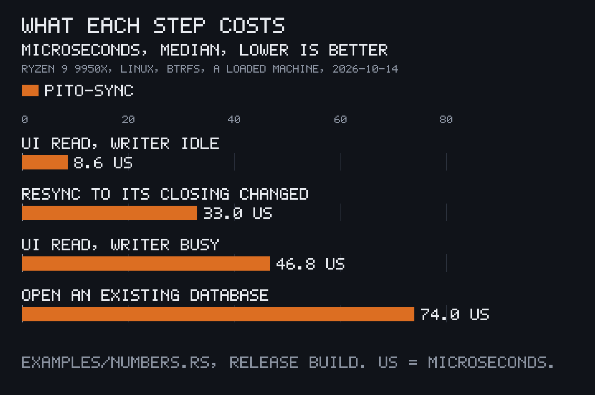

<p align="center"></p>

# pito-sync

[](https://github.com/gmrdad82/pito-sync/tags)

pito-sync is a small Rust crate for apps whose UI reads a local SQLite file
while background sources keep it up to date, part of [PITO MD](https://pitomd.com).
The UI never waits on the network: it reads its own database, and each source
syncs data into it on its own thread and says when something changed.

**A UI read takes 47 µs while a source rewrites 10,000 rows back to back, and
its p99 stays at 0.19 ms; the same code on SQLite's defaults has a p99 of
1.23 s.** 569 lines of Rust, one dependency.

Works on Linux and macOS (Windows through WSL).

Got questions or doubts? Ping me on Discord: https://discord.gg/XsNcn3kYzn

## At a glance

| What | Measured |
|---|---|
| A UI read (a page of 50 rows and the sync row), writer idle | 8.6 µs median |
| The same read while a source commits 10,000-row passes back to back | 46.8 µs median, 0.19 ms p99, 2.84 ms slowest |
| The same read and writer on SQLite's defaults | 73.5 µs median, 1.23 s p99 and slowest |
| `Resync` to its closing `Changed`, through the source's thread | 33.0 µs median, 0.74 ms p99 |
| A pass writing 10,000 rows in one transaction | 3.61 ms, 2.77 million rows a second |
| `open` of an existing database | 74.0 µs |
| `open` of a new one: its folder, the file and the schema, once per install or schema version | 144 ms |
| Library code | 569 lines of Rust in `src/`, tests aside |
| Dependencies | one, `rusqlite` 0.40 with SQLite compiled in; 9 crates in all |
| A whole app with SQLite inside (the `feed` example, release build) | 3.0 MB |
| A clean release build of the crate, SQLite included | 1 min 16 s at 4 jobs |

Measured once on 2026-10-14 with [`examples/numbers.rs`](examples/numbers.rs),
a release build, on an AMD Ryzen 9 9950X under Linux, the database on btrfs.
The machine was busy with other builds at the time (load average 65 on 32
threads), so these are numbers under load, not a quiet bench. Run it on yours:

```
cargo run --release --example numbers
```

## Install and first use

Add it to your `Cargo.toml` as a git dependency:

```toml
pito-sync = { git = "https://github.com/gmrdad82/pito-sync", tag = "v1.0.2" }
```

It needs Rust 1.97 or newer and a C compiler, since SQLite is compiled in:

- **Linux:** `sudo apt install build-essential` on Debian and Ubuntu,
  `sudo pacman -S base-devel` on Arch, or `gcc` from your distribution.
- **macOS:** the Xcode command line tools, `xcode-select --install`.
- **Windows:** inside WSL, as on Linux. Native Windows isn't supported: the
  crate sets Unix file permissions on the database.

Then see it run, the clip at the top:

```
git clone https://github.com/gmrdad82/pito-sync && cd pito-sync
cargo run --example feed
```

The whole idea in one file: a source that writes posts on its own thread, and
a UI loop that only reads.


```rust
use std::sync::mpsc;
use std::time::Duration;

use pito_sync::rusqlite::Connection;
use pito_sync::{Changed, Failure, Fault, Pass, Source, Spec};

const SCHEMA: &[&str] = &["CREATE TABLE posts (id INTEGER PRIMARY KEY, title TEXT NOT NULL)"];

struct Feed;

impl Source for Feed {
    fn name(&self) -> &str {
        "feed"
    }

    fn every(&self) -> Option<Duration> {
        Some(Duration::from_secs(300))
    }

    fn pass(&mut self, conn: &mut Connection, _id: Option<&str>) -> Result<usize, Failure> {
        let titles = ["Hello, world"];
        let pass = Pass { source: "feed", started_at: 0, finished_at: 0, failure: None, cursor: None };
        pito_sync::commit(conn, pass, |tx| {
            tx.execute("DELETE FROM posts", [])?;
            for title in titles {
                tx.execute("INSERT INTO posts (title) VALUES (?1)", [title])?;
            }
            Ok(titles.len())
        })
        .map_err(|e| Failure::new(Fault::BadAnswer, e.to_string()))
    }
}

fn main() -> Result<(), String> {
    let spec = Spec::new("state/feed.db", 1, SCHEMA);
    let (changed, changes) = mpsc::channel::<Changed>();
    let _asks = pito_sync::spawn_checked(&spec, Box::new(Feed), changed)?;
    for Changed(name) in changes {
        let ui = pito_sync::reader(&spec)?.ok_or("not built yet")?;
        let sync = pito_sync::sync(&ui, &name).map_err(|e| e.to_string())?;
        println!("{name}: {sync:?}");
    }
    Ok(())
}
```

## What it does

### The UI never waits


The UI reads through its own read-only connection, and every database is
opened in WAL with `synchronous=NORMAL`, so a reader never queues behind a
writer's commit. In the chart a source commits 10,000-row passes back to back
for three seconds while the UI reads a page of 50 rows and the sync row every
millisecond: 2,305 reads, the slowest 2.84 ms, while the source got through
415 passes. The same code on a plain connection with SQLite's defaults
(rollback journal, `synchronous=FULL`) managed 88 reads, the slowest stuck
behind the writer for 1.23 s, and 58 passes.

### Sources on their own threads



A source is a trait with one `pass`. `spawn` gives it its own thread and
connection, runs the first pass at once, then timed passes or a pass whenever
the app sends a `Resync`. Each pass sends a `Changed` when it starts and one
when it ends, so the UI shows "syncing…" with no extra wiring. A `Resync`
comes back as its closing `Changed` in 33 µs; a secret the app only has later,
such as a token after sign-in, goes in with `Message::Secret` and starts a pass.
The clip at the top is exactly that, and prints:

```
feed      syncing…
feed      no key: sign in first (0 posts kept)
feed      syncing…
feed      3 posts, newest "Threads that never block the UI"
feed      syncing…
feed      6 posts, newest "One file per app"
feed      syncing…
feed      unreachable: the server did not answer (6 posts kept)
feed      syncing…
feed      9 posts, newest "The sync table"
```

### One transaction per pass

A pass writes its rows and its bookkeeping row in one `BEGIN IMMEDIATE`
through `commit`, so the UI sees both or neither, never half a sync. Writing
10,000 rows that way takes 3.61 ms, 2.77 million rows a second:

```rust
let pass = Pass { source: "feed", started_at, finished_at: now(), failure: None, cursor: None };
pito_sync::commit(conn, pass, |tx| {
    tx.execute("DELETE FROM posts", [])?;
    let mut insert = tx.prepare_cached("INSERT INTO posts (title) VALUES (?1)")?;
    for title in &titles {
        insert.execute([title])?;
    }
    Ok(titles.len())
})
```

### One private database per app, kept as a cache

<p align="center"></p>

Each app keeps its own file, created 0600 in a 0700 folder, and every `open`
puts both back if something loosened them, as the clip shows. The file is a
cache, never migrated: when the app's schema version or the crate's own
`sync` table changes, `open` deletes the file with its `-wal` and `-shm` and
builds it fresh, in 144 ms once per install or version; opening it after that
takes 74 µs.

### Failures the UI can read back

A pass that fails returns a `Failure` with its kind: `no_key`, `refused`,
`forbidden`, `unreachable`, `bad_answer` or `rate_limited`. The thread records
it in the sync row and the rows the last good pass wrote stay, so the UI says
each kind its own way and still shows what it has:

```rust
return Err(Failure::new(Fault::RateLimited, "try again in a minute").until(Some(retry_at)));

match sync.error.as_deref().and_then(Fault::parse) {
    Some((Fault::NoKey, _)) => "sign in to see your feed".into(),
    Some((fault, message)) => format!("{}: {message} ({posts} posts kept)", fault.word()),
    None => format!("{posts} posts"),
}
```

A `retry_after` holds the timed passes back until then; a `Resync` the user
asks for still runs.

### Secrets that stay secret

```rust
let token = pito_sync::Secret::new(String::from("from the keyring"));
println!("{token:?}");
```

```
Secret(hidden)
```

A `Secret` hides in `Debug`, has no `Clone` or `Display`, and zeroes its
buffer, spare capacity included, when it drops. `expose()` is the only way
back to the value, and the crate never writes one to the database, a log or
an error.

### Small

569 lines of library code and one dependency: the crate re-exports `rusqlite`
(0.40, with SQLite bundled), so an app uses `pito_sync::rusqlite` and stays on
the same version. The `feed` example, a whole app with SQLite inside, is a
3.0 MB release binary.

## Reference

### Where the database goes

The app picks the path. A per-user state folder is the usual place:
`$XDG_STATE_HOME/<app>/` on Linux (`~/.local/state/<app>/` when it is unset)
and `~/Library/Application Support/<app>/` on macOS; the example's
`state_dir()` picks between them. Two apps never point at the same path.

### The contract

- **One database per app.** An app describes its file with a `Spec`: its path,
  its `version` and its `schema`, the `CREATE` statements of its own tables.
  The crate adds one table of its own, `sync`.
- **The UI never writes.** It reads through `reader(&spec)`, a read-only
  connection that is `None` until a writer has built the file and while the
  stored version differs, and re-reads when a `Changed` arrives. Writes come
  only from sources, through `commit`, one `BEGIN IMMEDIATE` per pass.
- **Opening.** `open(&spec)` sets WAL, `synchronous=NORMAL`,
  `busy_timeout=5000` and `foreign_keys=ON`. It creates the file 0600 and its
  folder 0700, and corrects both on every open.
- **Drop and rebuild.** The file is a cache, never migrated. The stored
  `user_version` is `spec.version * 1000 + SYNC_VERSION`
  (`spec.user_version()`), so a change on either side, the app's tables or the
  crate's `sync` table, rebuilds: when it differs, or the file isn't a
  database, `open` deletes the file with its `-wal` and `-shm` and builds it
  fresh. A version runs from 0 to `MAX_VERSION` (2147482), so the stamp fits
  SQLite's 32-bit `user_version`; anything else is refused.
- **Tests and fixtures** build the same database in memory with
  `memory(&spec)`.

### Sources and the runner

```rust
pub trait Source: Send {
    fn name(&self) -> &str;
    fn every(&self) -> Option<Duration>;
    fn pass(&mut self, conn: &mut Connection, id: Option<&str>) -> Result<usize, Failure>;
    fn secret(&mut self, name: &str, value: Secret) {}
}

pub fn spawn(spec: &Spec, source: Box<dyn Source>, changed: Sender<Changed>) -> Sender<Message>;
pub fn spawn_checked(spec: &Spec, source: Box<dyn Source>, changed: Sender<Changed>) -> Result<Sender<Message>, String>;
```

`spawn` runs one source on its own thread with its own connection and returns
the source's inbox. A name is any string the app builds; it keys the source's
`sync` row.

- **The first pass runs at once.** As soon as the thread has opened the file
  it runs a pass, so an app needs no start-up `Resync`. Only a `retry_after`
  an earlier run left that still holds keeps it back; the timed passes then
  pick it up.
- **Timed passes.** With `every` set, the thread then wakes every `every`, or
  every minute when that's longer, and runs a pass when it's `due`: no
  `retry_after` holds it, and the last pass failed or finished at least
  `every` ago. A failed pass is tried again at the next wake; a source that
  wants to wait longer says so with `retry_after`. With `every` at `None` it
  runs at start and then only when asked.
- **`Message::Resync(Resync(name, id))`** runs a pass at once, `retry_after`
  or not, and hands `id` to `pass` (a source might take `"full"` for a full
  resync). `Resync(..).into()` makes the message. An explicit resync always
  runs, even right after a pass: a user's refresh key, or a resync after a
  write, is never dropped.
- **`Message::Secret(name, Secret)`** hands a running source a secret it
  didn't have when it started, such as a key unlocked later or a token after
  sign-in. The thread calls `source.secret(name, value)`, whose default drops
  it, then runs a pass at once, never skipped.
- **`Changed(name)`** goes out twice per pass, ok or failed: when it starts,
  right after the thread marks it `started`, and when it ends. A UI re-reads
  on each and shows "syncing…" while `started_at > finished_at`, with no
  source cloning the sender. A pass ends by committing its rows, which stamps
  `finished_at`, or by returning `Err(failure)`, which the thread records with
  `failed`. If the file can't be opened the thread sends one `Changed` and
  stops. Dropping the inbox's `Sender` or the `Changed` receiver ends the
  thread.
- **`pass_once(conn, source, id) -> Result<usize, Failure>`** is that one pass
  on its own, on the calling thread: mark `started`, run `pass`, and record a
  failure with `failed`. The runner uses exactly this, adding only its two
  `Changed` sends. An app that needs a pass without a thread (a headless dump,
  a test) calls it instead of copying the sequence.

### A failed open

`spawn` opens the file on its thread, so a file that can't be opened shows
only as one `Changed` and a source that never passes. `spawn_checked` opens it
on the calling thread instead: it returns `Err` with `open`'s reason (`cannot
write <folder>: …`, `cannot open <file>: …`) and starts nothing, or moves the
open connection into the thread, which then runs exactly as `spawn`'s does.

### Secrets

`Secret::new(value)` takes the value, `expose()` is the only way back to it,
its `Debug` prints `Secret(hidden)`, and its buffer, spare capacity included,
is zeroed when it drops. It has no `Clone` and no `Display`. The crate writes
no secret to the database, a log, an error or `Debug` output, and a source
keeps it that way, never putting one in a `Failure`, a cursor or a row. Hand it
an owned `String` so no other copy is left behind.

### Bookkeeping

The `sync` table holds one row per source: `source`, `started_at`,
`finished_at`, `ok`, `error`, `cursor`, `rows` and `retry_after`, times in
milliseconds since the epoch.

- `started(conn, source, at)` marks a pass begun; the runner calls it before
  every pass.
- `commit(conn, Pass { source, started_at, finished_at, failure, cursor }, |tx| ...)`
  writes the pass's rows and its `sync` row in one `BEGIN IMMEDIATE`. A
  failure sets `ok = 0`, its `error` and its `retry_after`; a success clears
  them.
- `failed(conn, source, &failure)` records a failed pass: `ok = 0`, its
  `error` and its `retry_after`, and `finished_at` at the time of the failure
  (never before `started_at`), so the pass no longer reads as running. It
  leaves the data alone, and `rows` and `cursor` stay as the last successful
  pass left them.
- `sync(conn, source)` reads the row back, `retry_after(conn, source)` its
  hold, and `due(conn, source, every, now)` says whether a timed pass should
  run.

### Errors

`Fault` is the kind: `no_key`, `refused`, `forbidden`, `unreachable`,
`bad_answer` or `rate_limited`. `Failure { fault, message, retry_after }` is
stored as `kind: message` (`text()`), and `Fault::parse(&error)` reads it back
so the UI can say each kind its own way. `Failure::until(Some(at))` sets
`retry_after`: a timed pass waits until `at`, a resync doesn't.


## Part of PITO MD

pito-sync is one of the open building blocks of [PITO MD](https://pitomd.com),
a family of fast desktop and terminal apps and the tools that make them. It
works well next to:

- [pito-storekit](https://github.com/gmrdad82/pito-storekit), SQLite store
  mechanics for an app's own data: long jobs in slices, ordered migrations,
  daily backups.
- [pito-fetch](https://github.com/gmrdad82/pito-fetch), atomic, resumable
  downloads pinned to a sha256, for a source that pulls files.
- [pito-tui](https://github.com/gmrdad82/pito-tui) and
  [pito-hourglass](https://github.com/gmrdad82/pito-hourglass), a terminal UI
  that reads the database and an hourglass to show while a pass runs.
- [pito-jobs](https://github.com/gmrdad82/pito-jobs), live job records and
  progress lines for command-line tools.

The clips here are recorded with [prec](https://github.com/gmrdad82/prec) and
made GIFs with [pcod](https://github.com/gmrdad82/pito-codecs); the charts are
drawn with [pito-compare](https://github.com/gmrdad82/pito-compare).

## Contributing

Issues are welcome at
[github.com/gmrdad82/pito-sync/issues](https://github.com/gmrdad82/pito-sync/issues):
a bug with a small program or test that shows it, or an idea the crate should
cover. Pull requests aren't taken. Please read the
[code of conduct](CODE_OF_CONDUCT.md) first, and report a security issue
privately as [SECURITY.md](SECURITY.md) says.

## Build and test

```
bin/gate
```

`bin/gate` runs `cargo fmt --check`, `cargo clippy --all-targets -- -D
warnings`, the tests with [cargo-nextest](https://nexte.st) and the doctests;
the tests write only under `tmp/`. The clips are terminal recordings of the
examples, and the charts' data is in [docs/charts/](docs/charts/)
([NOTICE](NOTICE)).

## Licence


The code is MIT licensed ([LICENSE](LICENSE)), © Catalin Ilinca. The pito-sync
and PITO MD names and their logos are © Catalin Ilinca, all rights reserved, and
are not covered by the MIT licence ([TRADEMARKS.md](TRADEMARKS.md)).
